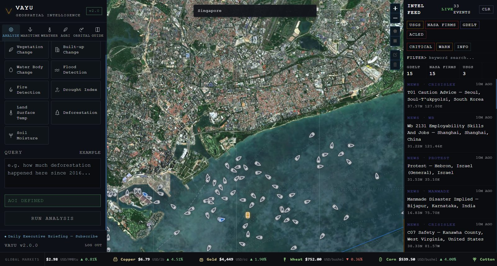
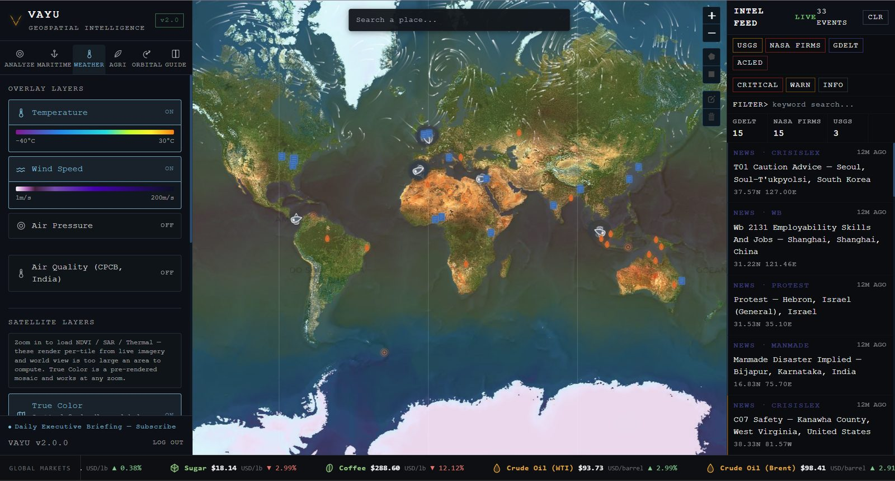
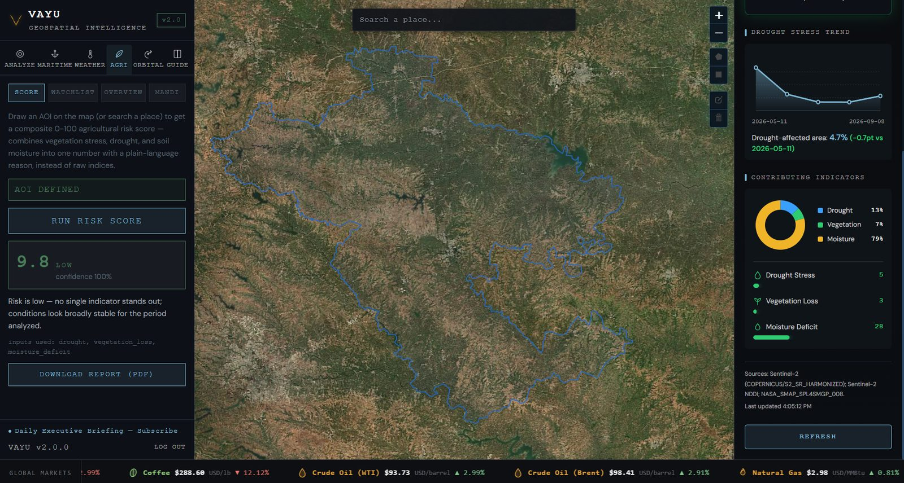
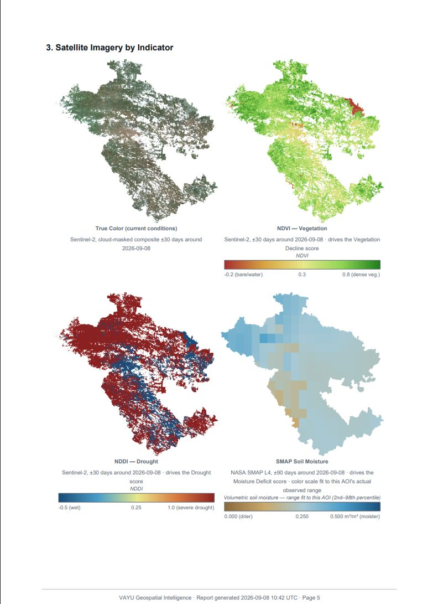
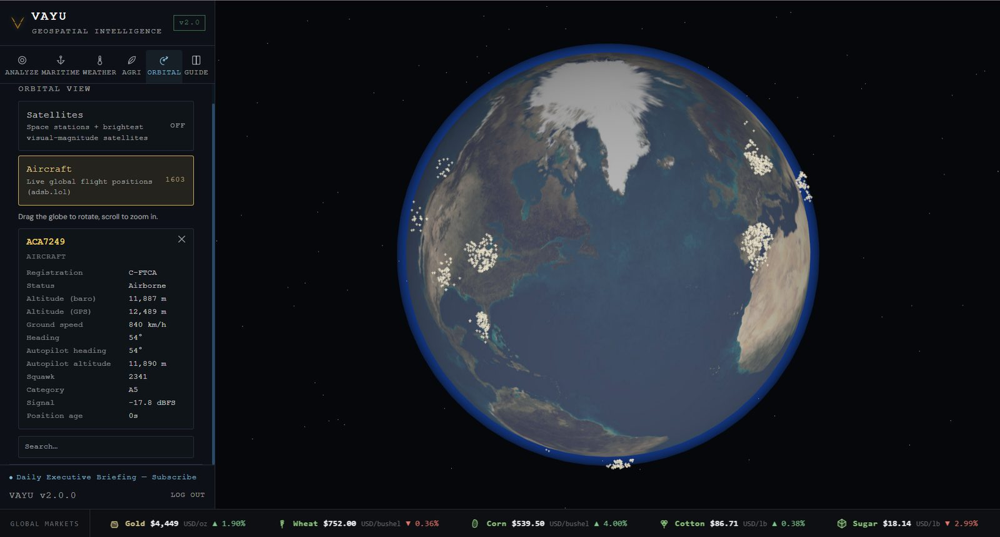

<p align="center">
  
</p>

<h1 align="center">VAYU</h1>
<p align="center"><b>Geospatial &amp; Business Intelligence Terminal</b></p>

<p align="center">
  <em>Satellite earth observation · remote sensing · maritime &amp; economic intelligence · agricultural risk scoring — unified in one live terminal.</em>
</p>

---

> **Abstract**
> Vayu is a web-based earth-observation and open-source-intelligence (OSINT) terminal that fuses **on-demand satellite analysis** over user-defined areas of interest with a **continuously streaming intelligence layer** — seismic activity, thermal anomalies, geolocated news, maritime traffic, commodity markets, and macroeconomic indicators. A dedicated **remote sensing toolkit** exposes the underlying spectral, radar, and terrain methods directly for domain researchers, while a **business intelligence layer** correlates chokepoint traffic, sanctions exposure, SEC disclosures, and economic-bloc data into a single auditable risk signal. An **agricultural module** applies the same satellite pipeline to a composite risk-scoring engine with region monitoring and automated alerting, plus a cited, seasonal **crop-suitability engine** with a held-out validation harness.
>
> Every computed result states its source dataset, spatial resolution, and formula alongside the number — this is built to be checked, not just read. Where a method is only a proxy (for example the water-quality indices) or has not yet been validated against documented events, the result and this README say so.

---

## Table of Contents

1. [Access Model](#access-model)
2. [Satellite Earth Observation](#satellite-earth-observation)
3. [Remote Sensing Toolkit — Spectra](#remote-sensing-toolkit--spectra)
4. [Business Intelligence](#business-intelligence)
5. [Agricultural Risk Module](#agricultural-risk-module)
6. [Scientific PDF Reporting](#scientific-pdf-reporting)
7. [Real-Time Intelligence Feeds](#real-time-intelligence-feeds)
8. [Weather &amp; Orbital Layers](#weather--orbital-layers)
9. [Platform: Theme, Mobile &amp; Landing Page](#platform-theme-mobile--landing-page)
10. [Validation &amp; Testing](#validation--testing)
11. [Architecture](#architecture)
12. [Project Structure](#project-structure)
13. [Deployment &amp; Configuration](#deployment--configuration)
14. [API Reference](#api-reference)
15. [Data Source Attribution](#data-source-attribution)
16. [Known Constraints](#known-constraints)
17. [Licensing](#licensing)

---

## Access Model

The landing page routes into one of four scoped terminal configurations (chosen from a tier picker or directly from the Tiers section) rather than a single undifferentiated view:

| Terminal | Tabs enabled | Intended for |
| --- | --- | --- |
| **Vayu Business** | Analyze, Business, Weather, Orbital | Markets, logistics, and macro/geopolitical analysis |
| **Vayu Agri** | Analyze, Weather, Agri | Agricultural risk monitoring and land condition |
| **Vayu Remote Sensing** | Analyze, Spectra, Weather | Domain remote sensing research (spectral/radar/terrain science) |
| **Vayu Full Terminal** | All six tabs | Unrestricted access |

There are no user accounts in the live build: the tier is a client-side choice (stored in `localStorage`). Account/session infrastructure (email+password signup, service-tier field, password reset) is implemented against a Postgres backend but disabled in favor of the tier picker above for the MVP — see the in-code banner comments in `frontend/src/components/AppGate.jsx` and `backend/app/api/auth_endpoints.py` for the exact restoration path.

<p align="center">
  
  <br /><sub>Analyze tab — AOI-defined satellite analysis, live vessel tracking, and the multi-source Intel Feed. (Earlier build; current tab set and layout have since expanded — see below.)</sub>
</p>

---

## Satellite Earth Observation

**Tab: Analyze**

1. **Spatial definition** — draw an arbitrary GeoJSON Polygon/MultiPolygon AOI on the interactive canvas, or search a place by name.
2. **Natural-language translation** — free-text analytical queries (e.g. *"Show vegetation loss in this area from 2020-01-01 to 2024-01-01"*) are parsed by an LLM-orchestrated pipeline into a discrete metric and time window.
3. **Computation** — Google Earth Engine executes the corresponding raster analysis; results return as structured metrics plus a rendered map layer.
4. **Toggleable satellite basemap layers**, independent of the query pipeline: true color, NDVI, SAR, thermal/IR.

| Analysis | Dataset | Application |
| --- | --- | --- |
| Vegetation Dynamics | Sentinel-2 SR Harmonized (NDVI) | Canopy/green-cover variance screening |
| Urban Expansion | Google Dynamic World V1 | Built-up growth, gain/loss/unchanged change map |
| Hydrological Variance | JRC Global Surface Water | Surface-water persistence/depletion, gain/loss/unchanged change map |
| Radar Flood Detection | Sentinel-1 SAR GRD + JRC GSW + SRTM DEM | SAR flood-extent mapping through cloud cover, with permanent-water and steep-terrain exclusion |
| Thermal &amp; Burn Scarring | MODIS Burned Area / Active Fire | Burned-footprint and thermal-event detection |
| Vegetative Stress | Sentinel-2 NDDI | Drought-stress screening, area-normalized |
| Thermal Profiling | Landsat 8/9 TIRS (Collection 2) | Surface temperature, urban heat island detection |
| Forest-Cover Loss | Hansen Global Forest Change | Multi-year tree-cover loss tracking |
| Subsurface Hydrology | NASA SMAP L4 | Soil-moisture variance, area-normalized |

Each of these 9 analyses can be exported as a source-cited PDF — see [Scientific PDF Reporting](#scientific-pdf-reporting).

---

## Remote Sensing Toolkit — Spectra

**Tab: Spectra** — 22 tools

A direct-access toolkit for domain researchers (IIRS/NRSC/ISRO-adjacent workflows) who need the underlying spectral/radar/terrain building blocks rather than a pre-packaged natural-language answer. Pick a tool, an AOI, and a date range; every result states its dataset, resolution, and formula alongside the numbers.

**What every tool returns** (the contract each one is built to):
* **Method + citation** — the formula or published method, and the dataset it ran on.
* **Uncertainty** — standard deviation and/or valid-pixel fraction, and the number of scenes or footprints behind the number.
* **Pixel-level map layer** where a map is meaningful (a Leaflet tile layer you can toggle on the map).
* **GeoTIFF download** of the underlying raster (raw values, not the stretched picture), and a client-side **CSV** export of any result.
* **Scene provenance** for composites — the exact scene IDs, dates and cloud % that fed the composite.
* A source-cited **PDF report** for any result (see [Scientific PDF Reporting](#scientific-pdf-reporting)).
* For tools that measure something over time, a one-click **"View as … timelapse"** that replays the layer over the same AOI and dates (see **Timelapse** below).

Results are cached (exact-match on tool + every parameter, 30-day TTL, Redis if `REDIS_URL` is set, in-memory otherwise), which is safe because a historical query over a fixed geometry and date range is deterministic.

### Optical, terrain and land cover

| Tool | Method | Dataset · Resolution |
| --- | --- | --- |
| **Spectral Indices** | NDVI (Rouse 1974), NDWI (McFeeters 1996), MNDWI (Xu 2006), NDBI (Zha et al. 2003), SAVI (Huete 1988), EVI (Huete et al. 2002), NDSI (Hall et al. 1995) | Sentinel-2 SR Harmonized, cloud-masked median composite · 10-20 m |
| **Spectral Composites ("X-ray" views)** | The same imagery through different band combinations: natural colour, colour infrared (vegetation vigour), SWIR B12-B8A-B4 (burn scars, haze), atmospheric penetration, agriculture/moisture, geology, plus a **Sentinel-1 SAR composite** (VV, VH, VV−VH) that sees through cloud. Published recipes (Sentinel Hub custom-scripts, Sentinel education band list, NASA Earth Observatory). Colours are a fixed display stretch, not a measurement — per-channel statistics, clipped-pixel shares and raw-band GeoTIFFs are provided for quantitative work | Sentinel-2 SR Harmonized + Sentinel-1 GRD · 10-20 m |
| **Terrain Analysis** | Elevation, slope, aspect. Aspect is circular data (0°≡360°) and is averaged via a unit-vector circular mean, not a naive arithmetic mean; hillshade layer | Copernicus DEM GLO-30 (TanDEM-X-derived) · 30 m |
| **Land Cover Classification** | 11-class area breakdown (tree cover, cropland, built-up, water, wetland, mangrove, etc.) with the dataset's official palette | ESA WorldCover v200, 76.7% validated overall accuracy · 10 m, 2021 |
| **Dynamic World (ML)** | Google/WRI's pretrained near-real-time 9-class land-cover model — no training needed; complements the custom classifier below | GOOGLE/DYNAMICWORLD/V1 · 10 m |
| **Snow Cover** | NDSI &gt; 0.4 classification threshold (Hall et al. 1995 — the same threshold MODIS's operational snow product uses) | Sentinel-2 SR · 20 m — resolves individual Himalayan valley glaciers far better than MODIS's native 500 m |
| **Change Detection** | A chosen spectral index differenced between two independent date ranges over the same AOI — per-period mean, delta and % change | Sentinel-2 SR · 20 m |
| **Burn Severity** | dNBR with the USGS FIREMON classes (Key &amp; Benson 2006) alongside **RBR** (Relativized Burn Ratio, Parks et al. 2014), which corrects for pre-fire vegetation density; the dNBR classes are applied to RBR only for side-by-side comparison, not as RBR's own calibrated cut-offs | Sentinel-2 SR · 20 m |
| **Timelapse** | A frame-by-frame timelapse of **natural colour, NDVI, night lights, NO₂, SAR backscatter or soil moisture** with **yearly, quarterly or monthly** frames (up to 60). Each frame is a composite of its period (Landsat/SAR: median; VIIRS/NO₂/SMAP: mean) drawn with one stretch shared by every frame, so frames are comparable. Played in-app with period labels and speed control; per-frame image count, valid-pixel fraction and AOI-mean value; a Mann-Kendall / Sen's slope trend for yearly frames only (a seasonal cycle would corrupt it otherwise). **Download as MP4 or GIF** (period label burned in; built server-side from the frames). The PDF report embeds **every frame** in a contact sheet. Periods with no usable data are skipped and listed. Also reachable with one click ("View as … timelapse") from the Night Lights, Spectral Indices, Spectral Composites, Atmosphere, SAR Backscatter and Soil Moisture results | Landsat 5/7/8/9 C2 L2 (30 m, 1984+), VIIRS DNB (2014+), Sentinel-5P NO₂ (mid-2018+), Sentinel-1 GRD (2014+), SMAP L4 (Apr 2015+) |
| **Forest Structure (GEDI)** | Canopy height (rh98) and aboveground biomass density (AGBD, with the model's own standard error) from spaceborne-lidar footprints, filtered with the Earth Engine catalog's own quality masks. Reports footprint statistics, footprint counts and density — **no area totals or carbon stock** are computed, because GEDI samples along orbit tracks and is not a probability sample of the AOI | GEDI L2A + L4A monthly rasters · 25 m footprints, 51.6°N–51.6°S, 2019 onward |
| **Water Quality (indicative)** | **Indicative only.** NDTI turbidity proxy (Lacaux et al. 2007) and NDCI chlorophyll proxy (Mishra &amp; Mishra 2012) over permanent water (JRC occurrence ≥ 90%). Uncalibrated relative indices for comparing places or dates within one waterbody — no NTU or chlorophyll-a concentrations are reported | Sentinel-2 SR + JRC GSW v1.4 · 20 m |

### Radar, water and atmosphere

| Tool | Method | Dataset · Resolution |
| --- | --- | --- |
| **SAR Backscatter** | VV/VH backscatter (dB) + Radar Vegetation Index. RVI is computed on *linear* backscatter power after converting from dB — a ratio of decibel values is not the same physical quantity as a ratio of the underlying power | Sentinel-1 GRD, dual-pol IW mode, all-weather day/night · 20 m |
| **Flood Mapping** | Before/after SAR change detection following UN-SPIDER's Recommended Practice: both periods from the same orbit pass, 50 m speckle smoothing, ratio on dB bands, permanent water (JRC occurrence ≥ 90%) masked out; VH default, VV for open-water delineation. The tool cannot verify a flood actually occurred in the window you give it | Sentinel-1 GRD · 10-20 m |
| **Surface Water Dynamics** | Water occurrence over 1984–2021, split into permanent (occurrence ≥ 90%) and seasonal | JRC Global Surface Water v1.4 · 30 m |
| **Soil Moisture** | Surface soil-moisture (`sm_surface`) mean snapshot over the period | NASA SMAP L4 · coarse (~10 km class) |
| **Land Surface Temperature** | Surface temperature from the Landsat thermal band — urban heat and drought stress | Landsat 8/9 Collection 2 Level-2 (ST_B10) |
| **Vegetation Drought Index** | Kogan's **VCI, TCI and VHI** (0–100): this window's NDVI and daytime land-surface temperature scaled against each pixel's own min/max for the same calendar window in 2001..(year−1); VHI = 0.5×VCI + 0.5×TCI, with drought classes. Relative to each pixel's own history, not an absolute drought measure; the number of baseline years actually used is reported. Window must sit inside one calendar year | MODIS MOD13Q1 NDVI (250 m) + MOD11A2 LST (1 km), analysed at 1 km |
| **Night Lights (VIIRS)** | Monthly night-time radiance (mean, σ, summed) with the cloud-free observation count behind each month, Mann-Kendall + Sen's slope. An economic-activity *proxy*, not a GDP measure; this product version is unfiltered (fires, boats, aurora included) and zero-observation months are shown as gaps, not darkness. Replayable as a timelapse | NOAA VIIRS DNB monthly, stray-light-corrected · ~464 m, 2014 onward |
| **Atmospheric Composition** | Tropospheric NO₂, SO₂, CO column densities and the absorbing aerosol index — column densities, not ground-level concentrations, so not comparable to a surface AQI monitor | Sentinel-5P / TROPOMI OFFL L3 · ~1 km grid, 2018 onward |

### Statistics, machine learning and validation

| Tool | Method | Dataset · Notes |
| --- | --- | --- |
| **Index Time Series** | A spectral index over time with a **Mann-Kendall** trend test and **Sen's slope** (`trend_stats.py`, unit-tested against known series) | Sentinel-2 SR |
| **ML Classify** | Random Forest (`ee.Classifier.smileRandomForest`, Breiman 2001) trained on points you click on the map, into whatever classes your analysis needs. Stratified held-out test split; reports **both** the (optimistic) training accuracy and the honest held-out test accuracy, clearly labelled | Sentinel-2 composite (6 bands + NDVI/NDWI/NDBI) |
| **Accuracy Assessment** | Confusion matrix, overall / producer's / user's accuracy and Cohen's kappa (Congalton 1991; `accuracy_stats.py`, unit-tested) of Land Cover, Dynamic World or Burn Severity against reference points you supply | Pure-Python statistics, GEE-independent |

> **Status of the newer tools.** The six most recently added tools (Spectral Composites, Vegetation Drought Index, Night Lights, Forest Structure, Timelapse, Water Quality) were built and checked against dataset catalogs and source papers, and their Python logic is unit/mocked-tested, but they have **not yet been run against live Earth Engine nor validated against documented real-world events**. See [Validation &amp; Testing](#validation--testing).

---

## Business Intelligence

**Tab: Business** — a wide, collapsible bottom panel with five views (Live / Markets / Analysis / Economics / Alerts), built specifically because cramming this much into a narrow sidebar made it unreadable. Press **Ctrl/Cmd+K** anywhere for the command bar, and use **Daily brief (PDF)** in the panel header for a one-document summary.

**What this is and is not.** The Business tab is a risk-and-context monitor for the physical world and for India, not a Bloomberg Terminal replacement. It does not have real-time licensed exchange data, fixed-income pricing, a professional messaging network or trade execution. Prices are reference quotes from Yahoo's unofficial API, typically 15–20 minutes delayed with no service-level guarantee, and **every figure carries its source, age and a STALE flag** (refreshed every 15 minutes; a symbol whose refresh fails keeps its last good quote, labelled stale, instead of vanishing).

### Live

* **Unified 0-100 business risk score** per monitored chokepoint (Strait of Hormuz, Strait of Malacca, Bab-el-Mandeb, Suez Canal, Strait of Gibraltar, Panama Canal, English Channel) — a deterministic, fully auditable weighted blend: 40% vessel-traffic anomaly (14-day rolling baseline z-score), 20% regional GDELT tone, 20% seismic proximity, 20% OFAC sanctions hits. No opaque model; every component and its weight is shown.
* **Dark-vessel (AIS-gap) detection** — flags vessels that stop transmitting AIS near a chokepoint and reappear elsewhere, further than plausible continuous transit would explain — a known sanctions-evasion/smuggling signature. Pure logic on the existing AIS stream, with a mass-disappearance guard so a bridge reconnect isn't mistaken for real gaps.
* **OFAC sanctions screening** — currently tracked vessels matched by name against the US Treasury SDN list (name-only match, disclosed as such — AIS provides MMSI+name, not IMO number).
* **Macro context** — US (FRED: fed funds rate, CPI, 10-year Treasury), Global, and India (World Bank: GDP growth, inflation) side by side.
* **Regional tone** — GDELT news coverage aggregated into geographic hotspots, most-negative-first, with sample headlines.
* **SEC exposure (EDGAR)** — on-demand full-text search of recent 8-K/10-K/10-Q filings mentioning a selected chokepoint.
* **Markets** — global stock indices (S&amp;P 500, Dow, Nasdaq, Nifty 50, Sensex, FTSE, Nikkei, Shanghai) and a *curated* set of bellwether equities tied to Vayu's own themes — energy majors (Reliance, ExxonMobil, Chevron), shipping/logistics (ZIM, FedEx) and defense (Lockheed, RTX) — rather than a generic ticker list.
* **Conflict forecast** — ACLED CAST: a monthly political-violence forecast per country, up to six months ahead, shown as observed-vs-forecast bars and explicitly labelled indicative. CAST access is granted by ACLED separately from the event feed, so the UI reports a distinct "no CAST access" status instead of failing silently.

### Markets

* **Watchlist for any symbol** (up to 12; Yahoo symbols such as `RELIANCE.NS`, `TCS.NS`, `AAPL`, `INR=X`), saved in your browser, with interactive charts (1M–5Y). Symbols are validated and fetched through a capped, cached server endpoint, so a watchlist cannot be used to hammer the upstream source.
* **India sector heatmap** — ten Nifty sector indices coloured by day change, with an honest "n of 10 available" (the sector symbols could not be live-checked from the build sandbox; any that Yahoo does not recognise are omitted rather than faked).
* **Indices, currencies and the dollar index** (including USD/INR) beside the watchlist.
* **One-page profiles** for a ticker or a strategic site (click "Open one-page profile" in a site's map tooltip, or use the command bar): live quote and price statistics (1m/3m/1y return, annualised volatility, max drawdown, position in the 52-week range — all descriptive, none a forecast) for tickers; signals, recent news and related bellwether tickers for sites; and linked chokepoints with their current risk band. Links exist only where already explicit in the code: the published chokepoint-bellwether mapping, and sites whose own description names a chokepoint.
* **Name/symbol search** — type "general motors" or "tata" in the watchlist box and pick a result. Matches come from the S&P 500 snapshot shipped in `backend/app/data/universe_sp500.csv` (503 companies with CIK and GICS sector; open `datasets/s-and-p-500-companies` data, derived from Wikipedia, CC BY-SA — refresh the CSV when index membership changes), Vayu's curated indices/FX/bellwethers, and Yahoo's keyless symbol search for everything else (unofficial; not live-tested from the build sandbox — if it fails, local matches still work).
* **Company page (ticker profile)** adds a price chart (3M/1Y/5Y), **annual financials from the SEC** (revenue, net income, operating income, operating cash flow, total assets, diluted EPS, growth and margins — exactly as the company tagged them in its 10-Ks via the free XBRL "company facts" API; US-GAAP filers only, so most non-US/Indian companies show a clear "no SEC data" message), and a **relationship map**.
* **Relationship map (suppliers ← company → customers)** — a free, honest take on Bloomberg's supply-chain view. There is no free complete supplier/customer database, so Vayu reads what companies must tell the SEC: the right side is customers named in the company's own latest 10-K (≥10%-of-revenue disclosures); the left side is other companies' 10-Ks, found with SEC full-text search, where this company is named in the same sentence as a revenue share. Click a node for the evidence sentence, percentage, filing date and a link to the filing; "Open map" re-centres on that company with breadcrumbs back. Every edge is labelled *extracted from filing text — verify*; anonymised customers ("Customer A") stay anonymised; a missing edge means "not found in the filings checked", never "no relationship". You can add relationships you know of (saved in your browser, dashed, marked as yours and unverified). The first look at a company reads up to ~9 filings (≤6 MB each) and can take up to a minute; complete results are cached for 24 h. The extraction logic is unit-tested on realistic sentences, but the SEC calls themselves could not be live-tested from the build sandbox. Set `SEC_USER_AGENT` (see below) — the SEC requires a real contact address.
* **Event impact** (on the ticker profile) — how a stock moved around dated events, compared with the market and with its own ordinary days. Events are dates you type (any event: a strike, a recall, a sanction) or **USGS earthquakes** ≥ a chosen magnitude inside a rough region box (Taiwan, Japan, Indian subcontinent, California, Chile, Turkey — boxes chosen by Vayu, not official regions; five years of history, one event per day). For each event: the move from the close before the event day to the close 0/1/3/5 trading days later, minus the benchmark's (^GSPC for US names, ^NSEI for `.NS`/`.BO`; no beta is estimated, so "abnormal" means "moved differently from the market", not "was caused by the event"). Context so a number is not read in a vacuum: the stock's own ordinary 5th–95th percentile range for each window, and, for ≥3 events, where the average sits among 2,000 averages of the same number of randomly chosen windows (fixed seed, reproducible) — an "unusualness" rank, deliberately not a significance test. Overlapping windows, weekend alignment and skipped dates are flagged. Statistics are unit-tested against hand-computed answers; the Yahoo and USGS calls could not be live-tested from the build sandbox.
* **Natural hazards — live** (top of the Markets view, and as map pins/feed items under sources `GDACS` and `NOAA Tsunami`): current **Orange/Red alerts for earthquakes, tropical cyclones, floods and volcanoes from GDACS** (UN/EU Global Disaster Alert and Coordination System; free, keyless; alert levels are GDACS's own assessment of severity and population exposure; polled every 30 min) plus the **latest message from NOAA's two tsunami warning centres** (tsunami.gov Atom feeds, polled every 5 min; severity shown is derived only from the message type — the linked official bulletin is authoritative). GDACS has no separate tsunami type (tsunami information arrives with earthquakes), so the NOAA feeds are the tsunami source. Each alert shows Vayu's own **market context**: chokepoints within 400 km (with their watch-commodities and bellwether tickers, from the existing chokepoint tables) and the affected country's home index where Vayu carries one (India, US, UK, Japan, China). **"Market reaction so far"** runs the event study (below) for that index vs the S&P 500 from the event's start date — on demand, descriptive, and honest when the event is too recent for any closes. An escalation (Orange → Red) is a new feed item. Context, never a forecast. GDACS and tsunami.gov could not be live-tested from the build sandbox; the parsers are tested on payloads shaped like GDACS's documented fields and tsunami.gov's Atom structure, including empty feeds, malformed coordinates and failures.
* **Event impact → Disasters mode**: pick a hazard type, a country and Orange+Red or Red-only, and Vayu pulls up to five years of GDACS events for that country and runs the event study for the symbol you are looking at ("floods in India → how did Nifty / this stock move?"). One event per start date, newest 40 analysed.
* **Indian company data**: Indian listed companies file financial results, shareholding patterns and governance reports (in XBRL) with BSE and NSE, but there is no free API — BSE's machine-readable corporate-data feed is sold under licence (via Deutsche Börse). The Financials panel therefore shows SEC data for US filers only, and for `.NS`/`.BO` symbols points to the NSE and BSE sites.
* **Latest news & filings** (on the ticker profile) — headlines that mention the company from **GDELT's DOC 2.0 API** (free, keyless, no monthly quota, "unlimited and unrestricted use" terms; its only limit is pacing — about one request per 5 seconds per IP, answered with HTTP 429 otherwise) plus the company's **latest official SEC filings** (8-K, 10-Q, 10-K, ... from the SEC submissions API, with plain-English labels for the standard Form 8-K item numbers, e.g. 2.02 = results of operations, 5.02 = director/officer change). No SerpApi or other paid search is used, so this does not touch the research agent's quota. To stay inside GDELT's pacing, every request goes through one server-wide pacer (one per 5.5 s, queue capped), results are cached 30 minutes per company and window (3/7/30 days), and the last good answer is served — marked stale — for up to 24 h if GDELT is throttling or down. English articles only; syndicated duplicates collapsed; only `https` links are rendered. A GDELT hit means the company is *mentioned*, possibly in passing; headlines belong to their publishers and are not summarised or scored. Non-US companies have no SEC filings here (the news part still works from the company name). The GDELT query shape was checked against its documentation and several working clients but, like the SEC calls, could not be live-tested from the build sandbox.
* **CSV exports** for markets and commodities.

### Alerts

Rules you set — a price crossing a level, a day move of at least N%, a chokepoint's risk band reaching elevated/critical, or a signal detected near a strategic site — checked every 5 minutes against one small `/intel/alerts-snapshot`. They fire when a condition *becomes* true (then stay quiet until it clears or 6 hours pass), never fire on stale or missing data, and arm silently if the condition is already true when you create them. **Alerts run in your browser** (any open Vayu tab, whichever tab of the app you are on) with an on-screen notice and optional desktop notifications. Emailed or WhatsApp alerts are deliberately not offered yet: they would need verified addresses (double opt-in), otherwise anyone could point alerts at someone else's inbox.

### Analysis

Historical charting for everything above that was previously current-value-only — commodities (Yahoo Finance chart API, 1M-5Y), US macro (FRED), Global/India macro (World Bank), and chokepoint vessel-traffic history (accumulated automatically every 15 minutes), and market indices/equities. A **chokepoint–market correlation** view ranks a chokepoint's highest traffic-anomaly days (z-score against the window's own mean/σ) and reports how its bellwether stocks moved on the same and next day — descriptive, with no fabricated correlation coefficient. Rendered with a dependency-free SVG chart: real Y-axis, multiple X-axis date markers, and a hover crosshair/tooltip showing the exact value at any point.

### Economics

* **India · food & fuel pressure** — Brent crude, USD/INR, wheat, sugar and cotton, each shown against *its own* last 12 months (percentile, 1m/3m change, sparkline), next to the state of the Hormuz, Malacca and Bab-el-Mandeb chokepoints. **There is deliberately no combined index**: weights would have to be invented, so every input is visible instead. The prices are global reference prices, not Indian domestic prices (mandi prices, rainfall and drought are in the Agri tab).
* **US Treasury yield curve** — today vs one month and one year ago, the 10Y−2Y and 10Y−3M spreads with an `inverted` flag, and the spread's history, from FRED's keyless CSV export of the Federal Reserve's H.15 data. Descriptive only: no recession probability is computed.
* **Bloc analysis** — G7 / G20 / BRICS / ASEAN, each with:
* **Macro rollup** — GDP growth + inflation for every member country (World Bank, fetched in parallel).
* **Regional tone** — GDELT coverage filtered by bloc/member-country name.
* **Commodity relevance** — which tracked commodities this bloc's members are major producers/exporters of. Explicitly editorial (not API-sourced); every entry carries its reasoning inline so it is reviewable rather than presented as fact.
* **SEC exposure** — EDGAR full-text search for the bloc's own name.

### Strategic sites

64 major ports, oil refineries, and mines (curated, hand-maintained — see `strategic_sites.py`), plotted on the map with live proximity-based signals (nearby earthquakes, dark-vessel flags, regional tone) **and** actual recent news headlines within 150 km, shown on hover with source, timestamp, and a direct link.

<p align="center">
  
  <br /><sub>Weather tab — temperature, wind, air-quality overlays, with the live commodity ticker along the bottom.</sub>
</p>

---

## Agricultural Risk Module

**Tab: Agri** — a compact sidebar for the core risk score, plus a wide bottom panel (matching the Business and Spectra bars) for the deeper tools.

**Sidebar (Score · Watchlist · Overview · Mandi)**
* **Composite 0-100 risk score** combining drought (NDDI), vegetation decline (NDVI threshold change), and soil-moisture deficit (SMAP) as a weighted average (40/35/25%), automatically renormalized if any indicator is unavailable.
* **Regional environmental context** — groundwater trend (GRACE), rainfall anomaly vs. a 10-year seasonal normal (CHIRPS), and land surface temperature (Landsat), reported separately from the composite score due to differing spatial resolution/timescale.
* **5-year seasonal NDVI baseline** — flags whether current conditions are unusual for that time of year at that location.
* **Region watchlist** with a farmer/officer feedback loop — confidence blends data completeness with the region's actual historical alert accuracy; an **automated alert engine** and a **WhatsApp bot** for last-mile delivery.
* **Mandi (market) price** overlay (data.gov.in / Agmarknet), with historical price trend (avg/CAGR) from CEDA.

**Bottom panel**
* **Groundwater** — regional groundwater trend from GRACE mascons (coarse, ~300 km grid; read as a regional signal, not a well-level one).
* **Analysis** — NDVI and groundwater trend charts side by side.
* **Crop Stage** — green-up / peak / senescence read from the AOI's own NDVI seasonal curve (`phenology.py`), filling the gap that the risk score is crop-agnostic.
* **Irrigation** — an *irrigate now / monitor / hold off* advisory that cross-checks SMAP soil-moisture dry stress against CHIRPS rainfall-vs-normal. A directional regional read, not a field-level prescription.
* **Crops** — ranked crop suitability for a point or AOI (crop requirements and season windows are India-focused; see below).
* **ML Extent** — Random Forest crop-extent classification, a thin wrapper over Spectra's ML Classify.

### Crop-suitability engine

Ranks a set of Indian crops (13 are evaluated seasonally) for a location from modeled soil (OpenLandMap 250 m), slope (Copernicus DEM), 10-year monthly rainfall (CHIRPS) and temperature (ERA5-Land). Full write-up: [`docs/AGRI_SUITABILITY_ENGINE.md`](docs/AGRI_SUITABILITY_ENGINE.md).

* **Seasonal, by observed practice.** A crop is scored in each season it is actually grown — Kharif (Jun–Oct), Rabi (Nov–Mar), Zaid (Mar–Jun), perennials year-round — with eligibility taken from Directorate of Economics &amp; Statistics area-by-season data, and the best season highlighted in plain language (e.g. jowar is evaluated in both kharif and rabi; wheat only in rabi).
* **Cited, auditable crop requirements.** EcoCrop-style trapezoids for temperature, rainfall and pH, plus texture, organic carbon and slope, each schema-validated in tests.
* **A constraint engine, not a black box.** One 0–1 score per factor; only an absolute temperature limit can make a crop *unsuitable*; everything else reduces the score but is floored; missing evidence lowers confidence and is never counted against a crop. The final score is the minimum over factors (the FAO limiting-factor rule), with the limiting factor named (*rainfall deficit*, *excess rainfall*, *dry-season length*, …).
* **Water is three separate questions** — deficit, excess (scaled by inferred drainage) and rainfall seasonality — and irrigation availability is inferred from the surrounding irrigated-cropland share (GFSAD1000) or set explicitly.
* **Farmer overrides and profit layer** — a soil-test can override the modelled soil, and a mandi-price-based revenue estimate is added per crop.
* **Honest calibration status.** Scores pass through an isotonic calibration that is the *identity until fitted* on a tune-split run, and the response says so (`calibration_status`). `confidence` is a data-completeness heuristic, not a statistical interval.

<p align="center">
  
  <br /><sub>Agri tab — composite risk score, contributing-indicator breakdown, and drought-trend chart for a drawn AOI.</sub>
</p>

---

## Scientific PDF Reporting

Every satellite analysis (the 9 Analyze-tab metrics, the agricultural risk score, and any Spectra result) exports as a structured PDF, not raw numbers. A **timelapse report embeds every frame** (a labelled contact sheet with each frame's value, image count and valid-pixel share), not a single image:

* Executive summary, study-area geometry, full methodology with a worked numeric example, indicator definitions and thresholds, results table, findings &amp; interpretation, data-quality/confidence section, recommendations, glossary, full dataset citations, and stated limitations.
* **Satellite imagery panels** (true color, NDVI, NDDI, SAR, thermal, SMAP as applicable) with proper legends, plus a dedicated gain/loss/unchanged **change map** for vegetation/built-up/water reports.
* Imagery captions disclose what was actually achievable for that run (cloud-free window used, % of AOI with valid pixels) rather than a fixed claim.
* An optional LLM-generated narrative, explicitly grounded in the same hedged, deterministic findings text shown elsewhere — never asserting more certainty than the underlying classification supports.

<p align="center">
  
  <br /><sub>Generated PDF report — true color, NDVI, NDDI, and SMAP panels with legends and methodology captions.</sub>
</p>

---

## Real-Time Intelligence Feeds

An asynchronous scheduler maintains persistent polling loops, deduplicating events into one server-side store and broadcasting them to connected clients via WebSocket.

**One shared feed for every visitor.** The server owns a single canonical feed; every device mirrors it rather than building its own from "whatever arrived since I opened the page":
* **Same list for everyone** — `GET /api/v1/intel/feed` and the WebSocket snapshot return the identical, deterministically ordered list (newest first by event time, capped at 500, with each source's newest 40 events always included so a high-volume source cannot crowd a quiet one out). A new visitor, a device that has been open for hours, and a reconnecting phone all show the same events.
* **Never stale, never obstructed** — there is deliberately no fixed "refresh every hour" cache, which would hide new events for up to an hour. Instead the serialized feed is cached *per version*: it is rebuilt the instant any event is ingested or expires, so a cache can never hide new data, while concurrent visitors between changes share one pre-serialized copy. The response carries an `ETag` (the feed's identity) and `Cache-Control: no-cache`, so clients revalidate and receive a tiny `304` until something actually changes.
* **Devices converge** — events are identified by a stable id and de-duplicated, a reconnect *replaces* the list instead of prepending a second snapshot, counters come from the server, and a device re-syncs when the server reports it fell behind, when a background tab becomes visible, and on a slow conditional check (a `304` while nothing changed).
* **Real event identity and time** — each event carries a stable `uid` (the source's own id where one exists) and, for USGS, FIRMS and GDELT, the event's real time rather than the moment it was fetched. The same earthquake no longer re-enters the feed on every poll, nearby *distinct* earthquakes (aftershocks) are no longer dropped by the spatial de-duplication, and a freshly started server rebuilds the same ordering. ACLED keeps its ingestion time because its dates are day-level.
* **Survives restarts** — a cold start backfills the full 24-hour window (previously 6 hours). If `REDIS_URL` is set, the newest events are also persisted (compressed, written when the feed changes and on shutdown) and restored on start, so a server that spun down on a free tier comes back with the feed it had. Without Redis it simply rebuilds from the sources; GDELT only exposes its latest 15-minute file, so its history after a cold start is thinner than on a long-running server.

| Source | Interval | Feeds |
| --- | --- | --- |
| USGS | 5 min | Global seismic events, M3.5+ |
| NASA FIRMS | 15 min | VIIRS active thermal hotspots |
| GDELT GKG | 10 min | Multilingual geolocated news events, with per-article sentiment (tone) |
| ACLED | 60 min | Political violence / conflict events |
| AISStream.io | Real-time | Live vessel positions in monitored chokepoints (via a dedicated `ais-bridge` service) |
| adsb.lol | Real-time | Live global aircraft positions (via `ais-bridge`) |
| Open-Meteo | 45 min | Global wind-vector field |
| data.gov.in | 15 min | CPCB air-quality stations, Agmarknet mandi prices |
| SEC EDGAR / OFAC / World Bank / FRED | On-demand / cached | Business intelligence layer — see above |

Vessels are auto-categorized (Tanker, Cargo/Bulk, Passenger, Fishing, Auxiliary) with route trails and a dead-reckoning predicted-path forecast; markers only redraw when heading or category actually changes.

---

## Weather &amp; Orbital Layers

**Tab: Weather** — temperature, wind speed (animated, backend-rendered), air pressure, and CPCB air-quality overlays; zoomed-in NDVI/SAR/thermal satellite tiles alongside satellite basemaps: a static Sentinel-2 true-colour mosaic (EOX), a fresh **True Color (Live)** Sentinel-2 composite (Earth Engine), and a **High-Res Close-Up** (Esri World Imagery, sub-metre in populated areas — Esri's real coverage varies by location, so the app requests tiles with `blankTile=false` and clamps the maximum zoom when a tile genuinely does not exist). A **Street View** toggle uses Mapillary crowdsourced imagery (coverage is sparse outside actively-mapped areas).

**Tab: Orbital** — a 3D globe (Three.js) with toggleable layers:
* **Satellites** — space stations and the brightest visual-magnitude objects, via TLE propagation (CelesTrak).
* **Aircraft** — live global positions with per-aircraft telemetry (altitude, heading, squawk, signal strength).
* **Vessels** — the same live AIS snapshot as the 2D map, drawn with the same per-category icons and colours (cargo, tanker, ferry, fishing, …), with a detail panel (MMSI, category, speed, course, destination).
* **Atmosphere** — a real, current NASA GIBS true-colour cloud composite in place of the static cloud texture, and real wind vectors (direction, speed, colour) from the same wind-field data the 2D map uses. A snapshot, not animated particle flow; it falls back to the static clouds if the GIBS layer is unreachable.
* **Live GOES panel** — genuinely live NOAA GOES-East (GOES-19) and GOES-West (GOES-18) full-disk imagery, ~10-minute cadence (free, keyless, public-domain). Himawari was deliberately not added: its free real-time feed's terms prohibit commercial use.
* **Close-up handoff** — zooming the globe in far enough hands off to a real 2D map centred on the point you were looking at, and zooming out eases the 3D camera back.

<p align="center">
  
  <br /><sub>Orbital tab — live global aircraft positions on a 3D globe, with per-aircraft telemetry.</sub>
</p>

---

## Platform: Theme, Mobile &amp; Landing Page

* **Command bar (Ctrl/Cmd+K)** — keyboard-first navigation: jump to any tab or Business view, chart or profile any symbol by typing it, or download the daily brief and CSV datasets. Real commands rank above symbol suggestions, and the Business commands only appear in tiers that include the Business tab.
* **Light/dark theme toggle** (persisted; applied through `--vayu-*` CSS custom properties across the app shell and every panel). The marketing landing page keeps its own dark palette by design.
* **Mobile** — the horizontal Business/Spectra/Agri tool bars are reachable on phones through a dedicated **Tools** tab in the bottom navigation (they are full-screen overlays there), their sub-tab rows scroll horizontally, and the tier picker scrolls on short viewports. A full mobile audit of every control has *not* been done.
* **No internet / can't reach Vayu** — three layers, all themed like the 404 page (gold on deep space) and all self-contained (no CDN: fonts are the open-licence Orbitron/Rajdhani files in `frontend/public/fonts`, SIL OFL licences included):
  1. **`public/offline.html` + `public/sw.js`** — a minimal service worker that does *one* thing: when a **page navigation** cannot reach the network (no internet, DNS failure, a connection hanging for 15 s, or a 502/503/504 from the host) it serves the cached themed "NO SIGNAL — Downlink interrupted · Seems there's no internet. · *Perhaps Vayu needs to enter the satnet industry as well.*" page at the URL the visitor asked for. The page probes a small file and **reloads automatically as soon as the site answers again**, has a Retry button, rotating punchlines, a "time since contact" clock, and respects reduced-motion. The worker never caches or rewrites the app's HTML/JS/API calls (so it cannot serve a stale Vayu), and normal responses — including your 404 — pass through untouched. It only helps visitors who have loaded Vayu online at least once (a service worker must be installed first); it is registered by `src/lib/registerOffline.js` in production web builds only, never in `vite dev` and never inside the Capacitor app. To retire it, bump `VERSION` in `sw.js` or unregister it; `nginx.conf` serves `sw.js`/`offline.html` with `no-cache`.
  2. **`ConnectionMonitor`** (in-app) — if the browser goes **offline while Vayu is open**, the same screen appears over the running app (Esc or "Keep viewing the last loaded data" dismisses it to a slim bottom banner; "Link re-established" toast on return). If the browser is online but Vayu's **server stops answering** (two failed heartbeats to `GET /health`, 30 s apart, only while the tab is visible), a slim banner explains that the servers may be waking up (free-tier hosts sleep when idle) — deliberately not a full-screen takeover, because the site itself still works.
  3. Verified in headless Chromium against a production build: worker installs and precaches; a real server shutdown shows the offline page and the page recovers ~2 s after the server returns; a host 503 shows it; a 404 stays your 404; the in-app screen, banner and toast appear on `offline`/`online`; no console errors. Those browser runs are not part of `npm run test:ui` (they need a bundled Chromium); the worker's decision logic, the page's behaviour and the registration rules **are** (`ui-tests/offline-static.mjs`, mutation-checked).
* **Landing page** — a real-time WebGL Earth in the hero (day/night terminator, ocean specular, independently rotating clouds, atmosphere glow; static-image fallback on mobile or without WebGL), an interactive 3D model of NASA's Landsat 7, and Home / About / Tiers / Developer / Contact sections with scroll choreography.

---

## Validation &amp; Testing

Credibility is the stated priority, so this section separates what *is* tested from what is not.

**Crop-suitability validation harness (`validation/`).** A held-out-by-design harness: ground truth is built from real district boundaries (Census-2011, datameet) and district-by-season crop statistics (Directorate of Economics &amp; Statistics, 2005–2014, via data.gov.in), covering ~60 districts across 22 states, with **whole states held out** as the test split so spatial autocorrelation cannot leak between tune and test. One command (`python validation/run_all.py --base-url …`) runs a self-test (metrics cross-checked against scikit-learn/SciPy) and every validator. Validator types cover crop ranking (top-1/top-k overlap against a naive baseline), scalar outputs (MAE, RMSE, bias, R², Lin's CCC, …), class areas, confusion matrices (OA, kappa, producer's/user's accuracy), event detection (ROC-AUC, POD, false-alarm rate) and phenology date error. See `validation/README.md` and `validation/ground_truth/SOURCES.md` (which states each source's limitations).

**Engine tests.** `backend/tests/` holds a sanity and invariant suite for the crop-suitability engine (schema validity of every crop profile, paired irrigation tests, constraint/explanation invariants, endpoint fuzzing) and a regression report. These run on approximate regional fixtures and are a **behavioural check, not accuracy evidence**.

**Statistics modules** (`trend_stats.py`, `accuracy_stats.py`) are pure Python and unit-tested against known/hand-worked cases.

**Business-tab tests.** Backend (`tests/test_business_data.py`, `test_business_analytics.py`, `test_business_endpoints.py`): data-quality and stale-retention logic, the watchlist service's validation/caching/capping, price statistics checked against hand calculations, the percentile and yield-curve maths, CSV formula-injection neutralisation, and the HTTP routes with upstream calls replaced. Frontend (`npm run test:ui`, 69 component checks plus 21 checks of the offline worker, page and registration, in `frontend/ui-tests/`): the real React components are mounted in a simulated DOM with realistic API fixtures and driven like a user — watchlist add/validate/cap/remove/persist and hostile saved data, the full alert lifecycle (arm, fire on a crossing, cooldown, stale data, toggle, persistence), the command bar, and the Business bar's cross-tab command handoff.

**Intel-feed tests** (`tests/test_intel_feed.py`) check that two visitors get the identical feed over REST and WebSocket, that the per-version cache can never hide a new event, `ETag`/`304` behaviour, identity-based de-duplication (and that aftershocks survive it), order-independence, per-source fairness, expiry, restore-after-restart without replaying history to clients, and failure-silent persistence.

**Timelapse and video tests** (`tests/test_timelapse_media.py`, `tests/test_spectra_timelapse.py`) encode real GIF and MP4 files from synthetic frames, check the Earth-Engine-host-only URL guard, period/label maths and error paths, and include a regression guard for a bug that only appears on live Earth Engine (arithmetic on images drops `system:time_start`, which silently emptied the drought index's date filters).

**Not yet done — stated plainly:**
* Spectra tools have **not** been validated against documented real-world events (for example a recorded wildfire for dNBR, a documented drought year for VHI, or a known reservoir filling for the Timelapse). This is the main credibility gap for scientific use.
* The six most recently added Spectra tools have not yet been run against live Earth Engine; their dataset IDs, bands, scale factors and formulas were checked against the Earth Engine catalog and source papers, and their Python logic is mocked-tested.
* No accuracy figure for the crop-suitability engine is claimed in this README; run the harness to produce one.

---

## Architecture

```text
React + Vite Interface (web, and Android via Capacitor)
  |- Satellite queries (NL + AOI) --------------> FastAPI /api/v1/query
  |                                                  |- Groq LLM: intent extraction & narrative synthesis
  |                                                  |- Google Earth Engine: raster computation
  |                                                  `- GeoJSON serialization + tile delivery
  |- Remote sensing tools (direct) --------------> FastAPI /api/v1/remote-sensing
  |                                                  |- 22 Spectra tools -> Google Earth Engine (optical, SAR, lidar, thermal, night lights)
  |                                                  |- Async job queue + exact-match result cache (Redis or in-memory)
  |                                                  `- trend_stats / accuracy_stats (pure-Python statistics)
  |- Business intelligence -----------------------> FastAPI /api/v1/intel
  |                                                  |- SEC EDGAR, OFAC SDN, GDELT, USGS, World Bank, FRED
  |                                                  |- AIS/ADS-B bridge, commodity prices (Yahoo)
  |                                                  `- Economic bloc + strategic site analysis
  |- Agri risk, crop suitability & PDF reports ---> FastAPI /api/v1/agri, /api/v1/report
  |                                                  |- Composite risk scoring (GEE) + GRACE/CHIRPS/Landsat context
  |                                                  |- Crop-suitability engine (soil/climate/terrain, seasonal, calibrated)
  |                                                  |- Phenology, irrigation advisory, groundwater, ML crop extent
  |                                                  `- reportlab-based PDF generation, source-cited
  |- Contact form ---------------------------------> FastAPI /api/v1/auth/contact (SQLite-persisted)
  `- Real-time WebSocket matrix <------------------ FastAPI telemetry engine
                                                     |- Asynchronous background polling daemons
                                                     |- Persistent AISStream WebSocket (via ais-bridge)
                                                     `- Agri alert-engine scheduler (watchlist scanning)
```

---

## Project Structure

```text
Vayu/
├── frontend/                        # React + Vite web UI, packaged for Android via Capacitor
│   └── src/
│       ├── App.jsx                   # Tab/state coordinator, map, layers, tier gating
│       ├── components/               # LandingPage, HeroEarth, SpectraPanel + SpectraIntelBar,
│       │                             #   AgriPanel + AgriIntelBar, BusinessIntelBar, EconomicsView, IntelPanel,
│       │                             #   OrbitalGlobe, GlobeCloseUpMap, LiveGoesPanel, StreetViewPanel, SparkChart, ...
│       ├── hooks/                    # WebSocket/polling abstractions (vessels, aircraft, satellites, wind, intel feed)
│       └── lib/                      # esriZoomGuard (location-aware Esri zoom clamping)
├── backend/
│   ├── app/api/                      # REST + WebSocket routers: query, intel, layers, agri, report,
│   │                                 #   reporting, auth, remote_sensing
│   ├── app/services/
│   │   ├── gee_client.py              # 9 natural-language-driven satellite metrics
│   │   ├── gee_remote_sensing.py      # Spectra toolkit -- the 22 remote-sensing tools
│   │   ├── gee_cache.py               # exact-match result cache for Spectra (Redis or in-memory)
│   │   ├── timelapse_media.py         # timelapse video (GIF/MP4) assembly + frame fetching for PDFs (Earth Engine hosts only)
│   │   ├── trend_stats.py             # Mann-Kendall + Sen's slope
│   │   ├── accuracy_stats.py          # confusion matrix, OA/kappa, producer's/user's accuracy
│   │   ├── report_generator.py        # source-cited PDF reports (Analyze, Agri, Spectra)
│   │   ├── intel/                     # Shared intel-feed store (versioned, cached, optionally persisted), vessel/aircraft tracking, GDELT/USGS/FIRMS/ACLED ingestion, ACLED CAST forecast,
│   │   │                             #   dark-vessel detection, sanctions, EDGAR exposure, macro, market indices,
│   │   │                             #   chokepoint-market correlation, economic blocs, strategic sites,
│   │   │                             #   supply-chain/business-risk scoring, commodity prices
│   │   ├── agri/                      # Risk scoring, seasonal baseline, region watchlist, alert engine, feedback,
│   │   │                             #   mandi price, WhatsApp bot, crop-suitability engine (crop_requirements,
│   │   │                             #   suitability_engine, evidence, calibration, crop_seasons), phenology,
│   │   │                             #   irrigation advisory, groundwater
│   │   ├── auth/                      # Postgres-backed accounts (built, currently disabled)
│   │   └── reporting/                 # PDF generation, daily executive summary emails
│   ├── app/core/                     # Configuration, logging, in-memory job/vessel storage
│   └── tests/                        # Crop-engine sanity/invariant suite + regression report
├── validation/                      # Held-out validation harness (ground truth, validators, metrics, self-test)
├── docs/                            # Crop-suitability engine write-up, regression and range-review reports
├── ais-bridge/                      # Standalone service: AISStream.io WebSocket + adsb.lol polling
└── docker-compose.yml
```

---

## Deployment &amp; Configuration

Create `backend/.env` (kept out of version control):

```dotenv
ENVIRONMENT=production
LOG_LEVEL=INFO
ALLOWED_ORIGINS_STR=https://your-domain

# Google Earth Engine -- required for Analyze and Spectra
GCP_PROJECT_ID=your-gcp-project-id
GOOGLE_APPLICATION_CREDENTIALS_JSON={"type": "service_account", ...}

# LLM narrative / query parsing
GROQ_API_KEY=your-groq-key

# Conflict events
ACLED_EMAIL=you@example.com
ACLED_PASSWORD=your-acled-password

# AIS/ADS-B bridge
AIS_BRIDGE_URL=https://your-ais-bridge-service
AIS_BRIDGE_API_KEY=your-bridge-shared-secret

# India datasets (data.gov.in) -- powers CPCB AQI + Agmarknet mandi prices
AQI_API_KEY=your-data-gov-in-key

# US macro (FRED) -- optional; business intel degrades to World Bank-only without it
FRED_API_KEY=your-fred-key

# Contact-form/admin viewing endpoints
ADMIN_API_KEY=your-chosen-admin-key
ADMIN_EMAIL=you@example.com

# Optional Redis: caches Spectra results and persists the intel feed across restarts; both fall back to in-memory (and silently
# fall back again if Redis is unreachable)
REDIS_URL=rediss://...

# SEC EDGAR requires a descriptive User-Agent with a real contact address (company financials, relationship map, full-text search)
SEC_USER_AGENT=Vayu Terminal you@yourdomain.com

# Historical mandi price trend (CEDA) -- optional
CEDA_API_KEY=your-ceda-key

# Daily executive-summary email -- optional (Resend, or Gmail SMTP)
RESEND_API_KEY=...
SMTP_USER=...
SMTP_PASSWORD=...

# Accounts (built, currently disabled -- see Access Model above)
DATABASE_URL=postgresql://...
```

The frontend additionally uses build-time variables: `VITE_API_URL` (backend base URL), `VITE_OWM_API_KEY` (OpenWeatherMap, free tier, for temperature/pressure tiles) and `VITE_MAPILLARY_ACCESS_TOKEN` (free Mapillary token for Street View; without it the toggle shows a clear "token missing" message).

#### Single-product demo sites (locked tier)

The same repo can be deployed as extra, single-product Vercel projects, so a domain expert only ever sees one tier. Create a new Vercel project from this repo (root directory `frontend`) and add the same variables as the main site plus:

```dotenv
VITE_LOCKED_TIER=agri      # business | agri | remote_sensing | full
```

With it set, the site skips the tier picker, ignores any saved tier, and (if the tier has an entry in `frontend/src/lib/tierLandingConfigs.js`) opens on that product's own 2D landing page; the page title, description and link-preview tags are set at build time. A tier with no landing entry opens its app directly. Leave it unset (as on `vayu-geop.vercel.app`) and nothing changes. Currently only `agri` has a landing page. Its hero backdrop `frontend/public/images/agri-bg.jpg` is a blurred composite of Vayu's own Sentinel-2 NDVI output and satellite basemap (not a stock photo); to use a different photo, replace that file (about 1920x1080, already blurred and darkened so text stays readable). The hero screenshot `agri-hero.jpg` is cropped from `screenshots/agri-dashboard.jpg` to show no other tier.

#### SEO (sitemap, robots, link previews)

Every build writes `robots.txt` and `sitemap.xml` into `dist/` and rewrites `index.html`'s `<head>` (title, description, canonical, Open Graph / Twitter tags, JSON-LD, and a plain-HTML `<noscript>` summary for crawlers that don't run JavaScript). The code is `frontend/src/lib/seo.js` + `siteSeo.js`, wired in `vite.config.js`; it is unit-tested. The app is one client-rendered page, so each site has exactly one indexable URL (`/`) and the sitemap lists that one URL.

The site's address is taken from `VITE_SITE_URL` (set this when you add a custom domain), otherwise from Vercel's `VERCEL_PROJECT_PRODUCTION_URL` (Vercel project setting "Automatically expose System Environment Variables", on by default). The main site falls back to `https://vayu-geop.vercel.app` if neither is set; a locked-tier site never falls back, and without a URL it skips the canonical/`og:url`/`og:image` tags and the sitemap and prints a build warning. Optional `VITE_GOOGLE_SITE_VERIFICATION` replaces the Search Console verification tag (needed on each separate site if you want it as its own Search Console property). Per-tier title, description and share image live in `tierLandingConfigs.js`.

Notes: this hides the other tiers' interface, but their code is still in the JavaScript bundle, so it is a demo-presentation lock, not an access-control boundary. Add each new site's URL to `ALLOWED_ORIGINS_STR` on the backend, or the browser will block its API calls. All sites share one backend and therefore its bandwidth cap. The PWA manifest still says "Vayu".

For local Earth Engine authentication:

```bash
earthengine authenticate
earthengine set_project YOUR_PROJECT_ID
```

### Local Development

```bash
# Backend
cd backend
python -m venv .venv && source .venv/bin/activate
pip install --upgrade -r requirements.txt
uvicorn app.main:app --host 127.0.0.1 --port 8000 --workers 1

# Frontend (separate terminal)
cd frontend
npm ci
npm run dev
```

Navigate to `http://localhost:5173`. Full OpenAPI schema at `http://localhost:8000/docs`.

**AIS bridge** (optional, for live vessel/aircraft tracking) — see `ais-bridge/README.md`. Deployed as a standalone service since AISStream.io permits one WebSocket connection per API key and needs a non-rate-limited IP range.

### Docker Compose

```bash
docker compose up --build -d
```

---

## API Reference

All routes are under `/api/v1`. The full, authoritative OpenAPI schema is served at `/docs`.

**Analysis and Spectra**

| Method | Path | Purpose |
| --- | --- | --- |
| `POST` | `/query` | Natural-language satellite analysis job over an AOI |
| `GET` | `/query/{id}` &middot; `/query/{id}/status` | Poll/retrieve a query job |
| `GET` | `/metrics` | List the supported Analyze-tab metrics |
| `POST` | `/remote-sensing/analyze` | Run a Spectra tool directly (async job, `202`); `tool` is one of the 22 tools below |
| `GET` | `/remote-sensing/analyze/{id}` | Poll/retrieve a Spectra job |
| `GET` | `/remote-sensing/analyze/{id}/video?format=mp4\|gif&fps=4` | Download a finished **timelapse** as an MP4 or GIF with period labels burned in (assembled from the job's stored frame images; `404` if the result has expired, `422` if the Earth Engine frame links have expired) |
| `GET` | `/remote-sensing/tools` | List available Spectra tools |
| `POST` | `/report/analysis` &middot; `/report/agri-risk` &middot; `/report/remote-sensing` | Source-cited PDF generation (Analyze metrics / agri risk / any Spectra result) |
| `GET` | `/report/business-brief` | One-document PDF of the Business tab (markets, commodities, chokepoint risk, notable events, India indicators, yield curve), each section stating its source, age and staleness |
| `GET` | `/layers/{layer_key}` | Cached satellite basemap tile URL |

Spectra `tool` values: `spectral_indices`, `spectral_composites`, `terrain`, `lulc`, `dynamic_world`, `snow_cover`, `change_detection`, `burn_severity`, `timelapse` (`frequency`: `yearly` \| `quarterly` \| `monthly`; `layer`: `natural_color` \| `ndvi` \| `night_lights` \| `no2` \| `sar_vv` \| `soil_moisture`), `gedi_forest_structure`, `water_quality`, `sar_backscatter`, `flood_mapping`, `surface_water_dynamics`, `soil_moisture`, `land_surface_temperature`, `vegetation_drought_index`, `night_lights`, `atmospheric_composition`, `index_time_series`, `supervised_classification`, `accuracy_assessment`.

**Agriculture** (`/agri`)

| Method | Path | Purpose |
| --- | --- | --- |
| `POST` | `/risk-score` &middot; `/baseline` &middot; `/drought-dashboard` | Composite risk score / seasonal NDVI baseline / drought dashboard |
| `POST` | `/crop-suitability` | Ranked, seasonal crop suitability for a point/AOI, with optional soil-test overrides and a mandi-based revenue estimate |
| `POST` | `/phenology` &middot; `/irrigation-advisory` &middot; `/groundwater-trend` &middot; `/ndvi-trend` &middot; `/crop-extent` | Crop stage / irrigation advisory / groundwater trend / NDVI trend / ML crop extent |
| `GET/POST` | `/regions` &middot; `DELETE /regions/{id}` | Watchlisted regions |
| `GET` | `/regions/{id}/alerts` &middot; `/alerts` &middot; `/rollup` | Alert history; officer/district role views |
| `POST` | `/feedback` &middot; `GET /feedback/accuracy` | Feedback loop |
| `GET` | `/mandi-price` | Market price overlay |
| `GET` | `/whatsapp/info` &middot; `POST /whatsapp/webhook` | WhatsApp bot |

**Intelligence** (`/intel`)

| Method | Path | Purpose |
| --- | --- | --- |
| `GET` | `/quotes?symbols=` &middot; `/quote-history?symbol=&range=` | Validated, cached, capped quotes and daily closes for any Yahoo symbol (watchlists, charts) |
| `GET` | `/asset-profile?kind=ticker\|site&id=` | One-page profile of a ticker or a strategic site |
| `GET` | `/india-risk` &middot; `/yield-curve` | India food-and-fuel indicators + chokepoint state; US Treasury yield curve and spreads |
| `GET` | `/alerts-snapshot?symbols=` | Everything the in-browser alert engine needs in one small (cached 60 s) response |
| `GET` | `/export/{markets\|commodities\|chokepoint-risk\|events\|yield-curve}.csv` | CSV downloads, formula-injection safe |
| `GET` | `/feed` | The shared intel feed: one identical, versioned copy for every visitor (`ETag` / `304`; rebuilt the moment an event arrives) |
| `GET` | `/events` &middot; `/events/aoi` &middot; `WS /ws` &middot; `/sources` &middot; `/stats` | Filtered/paginated events; live WebSocket (snapshot = the shared feed, then events, each carrying the feed version and server counters); sources and store statistics |
| `GET` | `/vessels` &middot; `/vessels/chokepoints` &middot; `/vessels/stats` &middot; `/aircraft` &middot; `/aircraft/stats` &middot; `/satellites/tle` | Live vessel / aircraft / satellite tracking |
| `GET` | `/business-risk` &middot; `/dark-vessels` &middot; `/sanctions-screen` &middot; `/seismic-disruption` | Chokepoint risk score and its components |
| `GET` | `/edgar-exposure/{chokepoint}` &middot; `/geo-tone` | SEC filings; GDELT regional sentiment |
| `GET` | `/macro` &middot; `/macro/history` &middot; `/macro/history/worldbank` | US/Global/India macro, current + historical |
| `GET` | `/commodities` &middot; `/commodities/history` &middot; `/markets` &middot; `/markets/history` | Commodity prices; stock indices and bellwether equities |
| `GET` | `/chokepoint-traffic-history` &middot; `/chokepoint-market-correlation` &middot; `/supply-chain-correlation` | Traffic history; traffic-anomaly vs market moves; chokepoint vs commodity moves |
| `GET` | `/conflict-forecast` | ACLED CAST monthly political-violence forecast per country |
| `GET` | `/strategic-sites` | Ports/refineries/mines with live signals + news |
| `GET` | `/economic-blocs` and `/{id}/macro` &#124; `/tone` &#124; `/commodities` &#124; `/exposure` | G7/G20/BRICS/ASEAN analysis |
| `GET` | `/wind-field` &middot; `/air-quality` &middot; `/air-quality/cpcb-stations` | Wind vector grid; air quality |

**Other:** `POST /auth/contact` (contact form, SQLite-persisted), `POST /subscribe` and `GET /unsubscribe` (daily executive summary), `GET /auth/contact/messages` and `/auth/admin/users` (admin, `X-Admin-Key` header). The `/auth/signup`, `/login`, `/logout`, `/forgot-password` and `/reset-password` routes belong to the disabled account system.

---

## Data Source Attribution

Every dataset used across the terminal, for reference:

**Satellite / Earth observation (via Google Earth Engine):** Sentinel-1 SAR GRD, Sentinel-2 SR Harmonized, Sentinel-5P TROPOMI, Landsat 5/7/8/9 Collection 2, MODIS (MOD13Q1 NDVI, MOD11A2 LST, Burned Area, Active Fire), VIIRS Day/Night Band monthly composites, GEDI L2A canopy height and L4A biomass, Hansen Global Forest Change, NASA SMAP L4, Google Dynamic World V1, JRC Global Surface Water v1.4, Copernicus DEM GLO-30, ESA WorldCover v200.

**Basemaps and live imagery:** EOX Sentinel-2 mosaic, Esri World Imagery, NASA GIBS (VIIRS true-colour clouds), NOAA GOES-East/West, Mapillary (crowdsourced street-level), NASA Blue Marble textures and NASA's public-domain Landsat 7 3D model.

**Weather/climate/agronomy:** Open-Meteo, GRACE (groundwater), CHIRPS (precipitation), ERA5-Land (temperature), OpenLandMap (soil), GFSAD1000 (irrigated cropland), FAO EcoCrop (crop requirement ranges), Directorate of Economics &amp; Statistics crop statistics and datameet Census-2011 district boundaries (validation ground truth).

**Business/markets:** Yahoo Finance (commodity prices), FRED (US macro), World Bank (global/country macro), SEC EDGAR (full-text filing search), US Treasury OFAC SDN list, AISStream.io (AIS), adsb.lol (ADS-B).

**News/events:** GDELT GKG, ACLED (event feed and CAST forecast), USGS, NASA FIRMS.

**India-specific:** data.gov.in (CPCB air quality, Agmarknet mandi prices), CEDA (historical mandi price trends).

Every non-satellite result in the app states its source dataset in a `method` field in the API response and, where surfaced, in the UI itself.

---

## Known Constraints

> [!IMPORTANT]
> * **State volatility:** background jobs and in-memory caches (vessel positions, intel events) reset on restart. Time-series data (chokepoint traffic, contact messages) is SQLite-persisted; account data is Postgres-backed when enabled.
> * **Telemetry variance:** satellite layers depend on cloud cover and orbital pass timing — coverage varies by season/AOI, and report captions disclose the actual achieved window/coverage rather than assuming a fixed composite.
> * **Commodity-relevance mapping is editorial**, not API-sourced — every entry states its reasoning so it can be reviewed, not treated as fact.
> * **Sanctions screening is name-only** (AIS provides MMSI+name, not IMO number) — a lead to verify, not a confirmed hit.
> * **No official free RBI data API exists** — India's repo rate is deliberately not included pending one; every third-party "RBI API" found is an unofficial paid scraper.
> * **Crop-agnostic agri risk score** — the composite risk score does not account for crop-specific growth stage or water requirements; read as a general land-condition signal for the AOI, not a per-parcel diagnosis. Crop-specific guidance comes from the separate crop-suitability, crop-stage and irrigation tools, each with its own stated limits.
* **Crop-suitability scores are not yet calibrated or accuracy-validated** — calibration is the identity until fitted, `confidence` is a completeness heuristic, and its validation is district-level against observed crop area (which reflects irrigation, prices and policy as well as suitability); see the harness's stated limitations.
* **Spectra validation is outstanding** — see [Validation &amp; Testing](#validation--testing). Proxy tools (Water Quality, Night Lights) are labelled as proxies; GEDI results are footprint statistics, not area totals.
* **Earth Engine dependence and quotas** — all satellite analysis runs on Google Earth Engine, so availability and quotas are Google's; very large AOIs at fine resolution can exceed GeoTIFF export limits (the download link is then omitted).
* **Business-tab data is reference-grade, not terminal-grade.** Quotes come from Yahoo's unofficial API (delayed, no SLA), the Nifty sector and FX symbols could not be live-checked from the build environment, there is no real-time exchange data, fixed-income pricing beyond the Treasury curve, messaging or execution, and the RBI repo rate is absent because RBI has no official free API. An economic-events calendar is not built (it needs a free FRED API key). Alerts run only while a Vayu tab is open.
* **Timelapse videos are built on demand** from Earth Engine frame links that may expire, so a very old result may need re-running before its video or PDF contact sheet can be built; encoding runs on the backend (bundled ffmpeg for MP4) and large timelapses add memory and bandwidth load on a free-tier host.
* **The themed offline page needs one prior online visit** (a service worker has to be installed first); a first-ever visit with no connection still shows the browser's own error. The in-app server-down banner relies on the backend's `/health` route and a free-tier host's cold-start time is a likely (not guaranteed) reason it appears.
* **Hosting limits** — the free-tier backend's monthly bandwidth cap can suspend the service; results are cached to reduce repeated Earth Engine work, but a cold start or suspension is visible to users.
> * **Resolution mismatch in the agri regional-context layer** — groundwater (GRACE, ~300 km grid) and rainfall (CHIRPS, ~5.5 km grid) are coarser/slower than the three scored risk indicators, hence reported separately from the composite score.

---

## Licensing

*Retained under private internal domain boundaries until explicit licensing assignment.*
